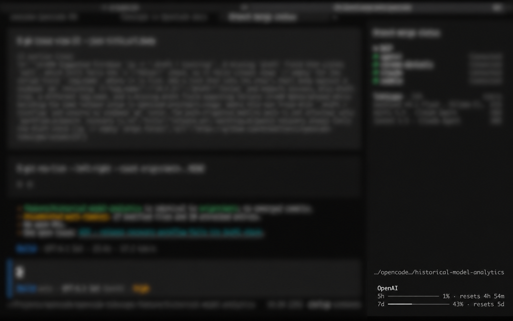
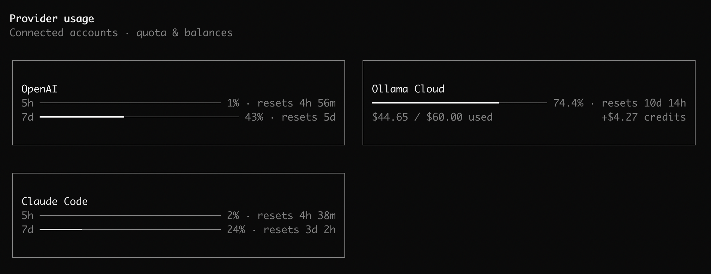
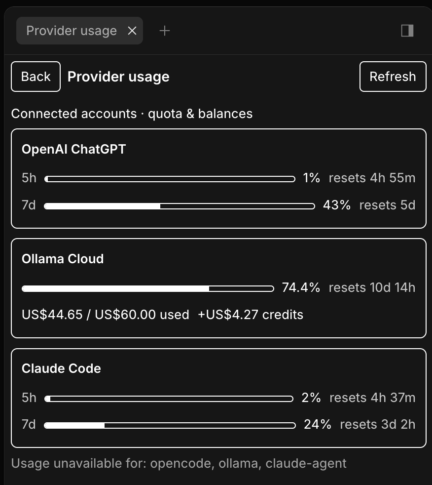

# opencode-providers-usage

[](https://www.npmjs.com/package/opencode-providers-usage)
[](https://github.com/mihaellenic/opencode-providers-usage/blob/main/LICENSE)
[](https://opencode.ai/docs/plugins/)

**How much quota do you have left on each provider?**

Provider quota for the OpenCode **terminal** and **desktop**: a sidebar card and a full-page dashboard showing only what each provider actually reports. No token estimates, guessed allowances, or inferred refills.

## Install

```bash
npm install opencode-providers-usage
```

## What it shows

- **Ollama Cloud**: included, purchased, and total credits, via your existing `ollama-cloud` API key.
- **OpenAI ChatGPT + Codex** (on by default): plan windows, reset times, and "Limit reached", using your existing file-backed Codex login read-only.
- **Claude Code**: session and week percentages with reset times, from the local CLI's `/usage`. See [Claude Code usage](docs/behavior.md#claude-code-usage).







## Use

- The **sidebar** follows the prompt's selected provider. Click it to open the full page.
- `/usage` (or `Show provider usage` in the palette) opens the full page. If `/usage` is taken, `/provider-usage` is used.
- `ctrl+r` refreshes all, `escape` goes back. `Refresh provider usage` in the palette refreshes the selected provider.

## Security

- Only the server reads credentials. The TUI sends `{ providerID }` and nothing else.
- Credentials, tokens, account IDs, and raw payloads never cross RPC or logs.
- Three allowlisted endpoints, no redirects, bounded responses. No inference, cookies, scraping, telemetry, or billing mutations.

Full list: [Security and privacy](docs/behavior.md#security-and-privacy).

## Compatibility

Built against `@opencode/plugin` `2.2.5`. No real host smoke has been run on that stack; earlier validation (OpenCode `2.1.4`, `2.2.0`–`2.2.2`) is historical and doesn't transfer. The Claude Code collector is verified only on macOS arm64 with CLI `2.1.308`. The Desktop GUI is experimental and verified only as listed in [Desktop GUI smoke results](docs/support.md#desktop-gui-smoke-results). Web, V1, and forks are unsupported.

## Development

```bash
npx bun@1.4.4 install --frozen-lockfile --ignore-scripts
npx bun@1.4.4 test
npx bun@1.4.4 run typecheck
npx bun@1.4.4 run lint
npx bun@1.4.4 run build
```

Tests are hermetic. Adding a provider: [`docs/adding-a-provider.md`](docs/adding-a-provider.md). Validation: [`docs/validation.md`](docs/validation.md). Releases: [`docs/releasing.md`](docs/releasing.md).
